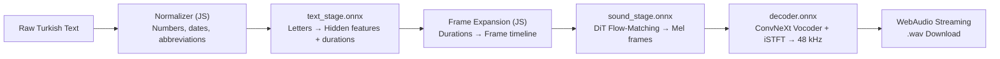
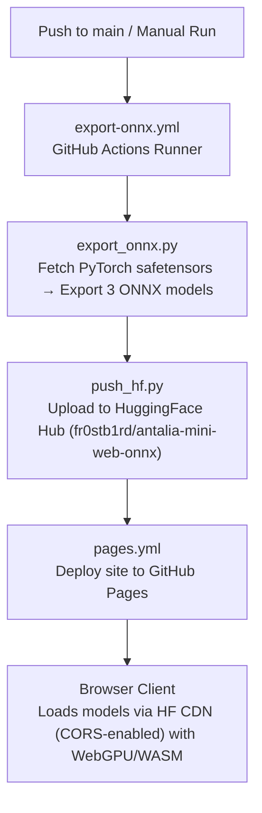

# ⚡ Antalia-2 Mini Web (ONNX)

**Offline Turkish TTS in your browser.**

[🇹🇷 Türkçe](README.tr.md) · **▶️ Live:** https://fr0stb1rd.github.io/antalia-mini-web/

Turkish text-to-speech web app — **runs 100% locally in your browser**.
No server, no API keys, your voice and text never leave your device.

Model: [cloud0day3/antalia-mini](https://huggingface.co/cloud0day3/antalia-mini) (PatientDesk AI) —
7.62M parameters (~30 MB fp32 / ~15 MB fp16), Apache-2.0 license.
Converts the model to ONNX and runs in the browser with `onnxruntime-web` + WebGPU/WASM + WebAudio.

## Features

- **Built-in Turkish Text Normalizer:** Automatically reads numbers, decimals, ordinals, dates, clock times, percentages, currency, and abbreviations naturally.
- **Ultra-Fast Streaming:** Sentences are synthesized and streamed one by one; audio starts playing on the first sentence while subsequent ones generate in the background.
- **Flow-Matching + Shortcut Self-Consistency:** 8-step DiT inference with CFG 2.0, baked into the ONNX model at export time for optimal quality-speed balance. Can be re-exported with `--steps 4` or `--steps 2` for faster variants.
- **Zero Bandwidth on Repeat Visits:** ONNX models are cached in the browser via the Cache Storage API.
- **Privacy First:** 100% client-side WebGPU/WASM execution.

## Architecture

The PyTorch pipeline is split into three ONNX stages for browser streaming:

| Stage | Input | Output | Notes |
|---|---|---|---|
| `text_stage.onnx` | `ids [B,L]`, `mask [B,L]` | `h [B,L,192]`, `logd [B,L]` | ConvNeXt + RoPE Self-Attention + Duration Predictor |
| `sound_stage.onnx` | `cond [B,T,192]`, `fmask [B,T]`, `noise [B,T/2,256]` | `mel [B,128,T]` | 5-block DiT Flow-Matching (8 steps, CFG 2.0) |
| `decoder.onnx` | `mel [B,128,T]` | `audio [B,S]` | Vocos ConvNeXt + ConvTranspose1d iSTFT head (48 kHz) |

## Automated CI/CD Pipeline

Everything is automated via GitHub Actions:

### Setup Secrets (One-time)

1. Create a public model repository named `antalia-mini-web-onnx` at [huggingface.co/new-model](https://huggingface.co/new-model).
2. Create a write token at [huggingface.co/settings/tokens](https://huggingface.co/settings/tokens).
3. Add it as `HF_TOKEN` in your GitHub repository: **Settings** → **Secrets and variables** → **Actions**.

## License

- Antalia-2 Mini model weights and code: Apache-2.0.
- Web application: Apache-2.0.
