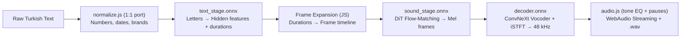
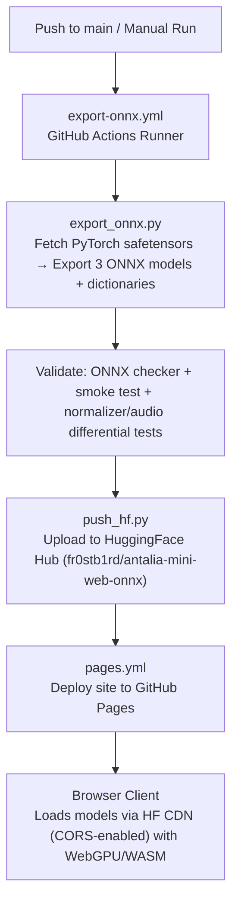

# ⚡ Antalia-2 Mini Web (ONNX)

**Offline Turkish TTS in your browser.**

[🇹🇷 Türkçe](README.tr.md) · **▶️ Live:** https://fr0stb1rd.github.io/antalia-mini-web/

[](https://github.com/fr0stb1rd/antalia-mini-web/actions/workflows/pages.yml)
[](https://github.com/fr0stb1rd/antalia-mini-web/actions/workflows/export-onnx.yml)

Turkish text-to-speech web app — **runs 100% locally in your browser**.
No server, no API keys, your voice and text never leave your device.

Model: [cloud0day3/antalia-mini](https://huggingface.co/cloud0day3/antalia-mini) (PatientDesk AI) —
7.62M parameters, 48 kHz output, one synthetic male voice, Apache-2.0 license.
Converted to ONNX and run in the browser with `onnxruntime-web` + WebGPU/WASM + WebAudio.
First launch downloads ~50 MB (3 ONNX models + 4 dictionaries), then works fully offline.

## Features

- **1:1 Turkish Text Normalizer (`normalize.js`):** a line-by-line port of the original Python normalizer, matching its output on 9,000+ inputs (verified by tests on every CI run). Reads numbers (`1250`), decimals (`68,5` → `... buçuk`), ordinals (`2.`), dates (`15.10.2026`), times (`14:30`), percentages (`%18`), money (`1.250,75 TL` → lira + kuruş), phones, e-mails/URLs, abbreviations (`Dr.` → `doktor`, `SGK` → `segeka`, `THY` → `teheye`), Roman numerals and English/brand words (`GitHub` → `git hab`).
- **Identical output tone & pauses (`audio.js`):** the release tone path (+6 dB low-shelf at 210 Hz, −9 dB high-shelf at 4 kHz, soft limiter) and inter-chunk pauses (0.12 s after sentences, 0.06 s otherwise), sample-identical to the original within float32 tolerance.
- **49 showcase examples** in 9 categories (numbers, money, phones, brands, abbreviations…) demonstrating the normalizer.
- **Ultra-Fast Streaming:** sentences synthesize and stream one by one; audio starts on the first sentence while the rest generate in the background, with live word highlighting.
- **Flow-Matching + Shortcut Self-Consistency:** 8-step DiT inference with CFG 2.0, baked into the ONNX model at export time. Re-export with `--steps 4` or `--steps 2` for faster variants.
- **Zero Bandwidth on Repeat Visits:** models and dictionaries are cached via the Cache Storage API (1-day TTL).
- **Privacy First:** 100% client-side WebGPU/WASM execution.

## Architecture

The PyTorch pipeline is split into three ONNX stages for browser streaming:



| Stage | Input | Output | Notes |
|---|---|---|---|
| `text_stage.onnx` | `ids [B,L]`, `mask [B,L]` | `h [B,L,192]`, `logd [B,L]` | ConvNeXt + RoPE Self-Attention + Duration Predictor |
| `sound_stage.onnx` | `cond [B,T,192]`, `fmask [B,T]`, `noise [B,T/2,256]` | `mel [B,128,T]` | 5-block DiT Flow-Matching (8 steps, CFG 2.0) |
| `decoder.onnx` | `mel [B,128,T]` | `audio [B,S]` | Vocos ConvNeXt + ConvTranspose1d iSTFT head (48 kHz) |

Browser dictionaries (built at export, served from HF): `foreign_dict.json` (80k phonetic respellings), `foreign_parts.json` (37k CamelCase parts), `known_words.json` (6k anti-respell shield), `english_i.json` (14k dotted/dotless-I decisions).

## Automated CI/CD Pipeline

Everything is automated via GitHub Actions:



### Setup Secrets (One-time)

1. Create a public model repository named `antalia-mini-web-onnx` at [huggingface.co/new-model](https://huggingface.co/new-model).
2. Create a write token at [huggingface.co/settings/tokens](https://huggingface.co/settings/tokens).
3. Add it as `HF_TOKEN` in your GitHub repository: **Settings** → **Secrets and variables** → **Actions**.

### Tests

```bash
python3 tests/make_fixtures.py   # regenerate oracle fixtures from Python
node --test tests/test_normalize.mjs tests/test_audio.mjs
```

## License

- Antalia-2 Mini model weights and code: Apache-2.0 (see `LICENSE` and `NOTICE` — the NOTICE attribution from the original release is included verbatim).
- Web application (`app.js`, `normalize.js`, `audio.js`, …): Apache-2.0.
