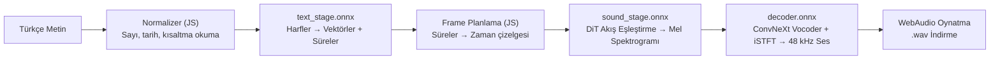
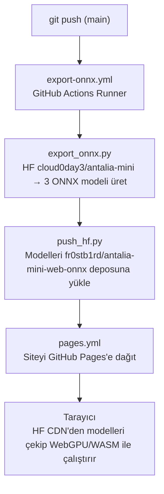

# ⚡ Antalia-2 Mini Web (ONNX)

**Tarayıcınızda çevrimdışı çalışan Türkçe Metinden Sese (TTS) yapay zeka modeli.**

[English](README.md) · **▶️ Canlı Site:** https://fr0stb1rd.github.io/antalia-mini-web/

Türkçe metinden sese web uygulaması — **%100 yerel olarak tarayıcınızda çalışır**.
Sunucu yok, API anahtarı yok, sesiniz veya yazdığınız metinler asla cihazınızdan dışarı çıkmaz.

Model: [cloud0day3/antalia-mini](https://huggingface.co/cloud0day3/antalia-mini) (PatientDesk AI) —
7.62M parametre (~30 MB fp32 / ~15 MB fp16), Apache-2.0 lisansı.
Model ONNX formatına dönüştürülür ve tarayıcıda `onnxruntime-web` + WebGPU/WASM + WebAudio ile çalıştırılır.

## Öne Çıkan Özellikler

- **Dahili Türkçe Metin Normalizer:** Sayıları ("1250" → "bin iki yüz elli"), tarihleri ("15.10.2026"), saatleri ("14:30"), yüzdeleri ("%25"), para birimlerini ("2.500 TL") ve kısaltmaları ("dr.", "km", "SGK") otomatik ve doğal okur.
- **Kesintisiz Akış (Streaming):** Cümleler parça parça üretilir; ilk cümle hemen çalmaya başlarken arkadaki cümleler arka planda üretilmeye devam eder.
- **Akış Eşleştirme + Shortcut Self-Consistency:** 8-adımlı DiT çıkarımı ve CFG 2.0, en iyi kalite-hız dengesi için export aşamasında ONNX modeline gömülmüştür (`--steps 4` veya `--steps 2` ile daha hızlı varyantlar da üretilebilir).
- **Sıfır Bant Genişliği:** Modeller tarayıcı Cache Storage API'sine kaydedilir; sonraki ziyaretlerde internet kotanızdan yemez.
- **Gizlilik:** Tamamen istemci taraflı WebGPU / WASM çalışması.

## Mimari

PyTorch modeli, tarayıcıda akışlı oynatma için 3 aşamaya bölünmüştür:

## Otomatik İş Akışı (CI/CD)

Her şey GitHub Actions tarafından otomatik yürütülür:

### Tek Seferlik Kurulum (Secrets)

1. [huggingface.co/new-model](https://huggingface.co/new-model) adresinde `antalia-mini-web-onnx` adında açık (public) bir model reposu oluşturun.
2. [huggingface.co/settings/tokens](https://huggingface.co/settings/tokens) adresinden `write` yetkili bir token alın.
3. GitHub reponuzda **Settings** → **Secrets and variables** → **Actions** kısmına `HF_TOKEN` adıyla ekleyin.

## Lisans

- Model ağırlıkları ve kod: Apache-2.0.
- Web uygulaması: Apache-2.0.
