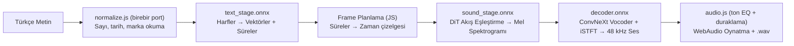
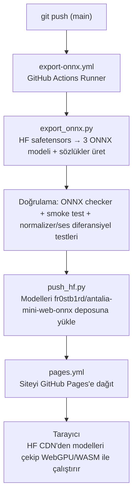

# ⚡ Antalia-2 Mini Web (ONNX)

**Tarayıcınızda çevrimdışı çalışan Türkçe Metinden Sese (TTS) yapay zeka modeli.**

[English](README.md) · **▶️ Canlı Site:** https://fr0stb1rd.github.io/antalia-mini-web/

[](https://github.com/fr0stb1rd/antalia-mini-web/actions/workflows/pages.yml)
[](https://github.com/fr0stb1rd/antalia-mini-web/actions/workflows/export-onnx.yml)

Türkçe metinden sese web uygulaması — **%100 yerel olarak tarayıcınızda çalışır**.
Sunucu yok, API anahtarı yok, sesiniz veya yazdığınız metinler asla cihazınızdan dışarı çıkmaz.

Model: [cloud0day3/antalia-mini](https://huggingface.co/cloud0day3/antalia-mini) (PatientDesk AI) —
7,62M parametre, 48 kHz çıkış, tek sentetik erkek sesi, Apache-2.0 lisansı.
Model ONNX formatına dönüştürülür ve tarayıcıda `onnxruntime-web` + WebGPU/WASM + WebAudio ile çalıştırılır.
İlk açılışta ~50 MB (3 ONNX modeli + 4 sözlük) iner, sonrası tamamen çevrimdışıdır.

## Öne Çıkan Özellikler

- **Birebir Türkçe Metin Normalizer (`normalize.js`):** orijinal Python normalizer'ın satır satır portu; 9.000'i aşkın girdide Python çıktısıyla birebir eşleşir (her CI koşusunda testlerle doğrulanır). Sayıları (`1250`), ondalıkları (`68,5` → `altmış sekiz buçuk`), sıra sayılarını (`2.`), tarihleri (`15.10.2026`), saatleri (`14:30`), yüzdeleri (`%18`), parayı (`1.250,75 TL` → lira + kuruş), telefonları, e-posta/web adreslerini, kısaltmaları (`Dr.` → `doktor`, `SGK` → `segeka`, `THY` → `teheye`), Roma rakamlarını ve marka/İngilizce sözcükleri (`GitHub` → `git hab`) okur.
- **Birebir ses tonu ve duraklamalar (`audio.js`):** release ton yolu (210 Hz'de +6 dB low-shelf, 4 kHz'de −9 dB high-shelf, soft limiter) ve parça arası sessizlikler (cümle sonu 0,12 sn, diğer 0,06 sn); float32 toleransında orijinalle örnek-örnek aynı.
- **9 kategoride 49 hazır örnek** (sayı, para, telefon, marka, kısaltma…) — normalizer vitrini.
- **Kesintisiz Akış (Streaming):** Cümleler parça parça üretilir; ilk cümle hemen çalmaya başlarken kalanı arkada üretilir, okunan kelime canlı işaretlenir.
- **Akış Eşleştirme + Shortcut Self-Consistency:** 8-adımlı DiT çıkarımı ve CFG 2.0, export aşamasında ONNX modeline gömülmüştür (`--steps 4` veya `--steps 2` ile daha hızlı varyantlar üretilebilir).
- **Sıfır Bant Genişliği:** Model ve sözlükler Cache Storage API'sine kaydedilir (1 günlük ömür); sonraki ziyaretlerde kota yemez.
- **Gizlilik:** Tamamen istemci taraflı WebGPU / WASM çalışması.

## Mimari

PyTorch modeli, tarayıcıda akışlı oynatma için 3 aşamaya bölünmüştür:



Tarayıcı sözlükleri (export'ta üretilir, HF'den sunulur): `foreign_dict.json` (80 bin fonetik karşılık), `foreign_parts.json` (37 bin CamelCase parçası), `known_words.json` (6 bin respell kalkanı), `english_i.json` (14 bin noktalı/noktasız I kararı).

## Otomatik İş Akışı (CI/CD)

Her şey GitHub Actions tarafından otomatik yürütülür:



### Tek Seferlik Kurulum (Secrets)

1. [huggingface.co/new-model](https://huggingface.co/new-model) adresinde `antalia-mini-web-onnx` adında açık (public) bir model reposu oluşturun.
2. [huggingface.co/settings/tokens](https://huggingface.co/settings/tokens) adresinden `write` yetkili bir token alın.
3. GitHub reponuzda **Settings** → **Secrets and variables** → **Actions** kısmına `HF_TOKEN` adıyla ekleyin.

### Testler

```bash
python3 tests/make_fixtures.py   # oracle fixture'ları Python'dan yeniden üret
node --test tests/test_normalize.mjs tests/test_audio.mjs
```

## Lisans

- Model ağırlıkları ve kod: Apache-2.0 (`LICENSE` + `NOTICE` — orijinal release'in atıf dosyası aynen dahildir).
- Web uygulaması (`app.js`, `normalize.js`, `audio.js`, …): Apache-2.0.
